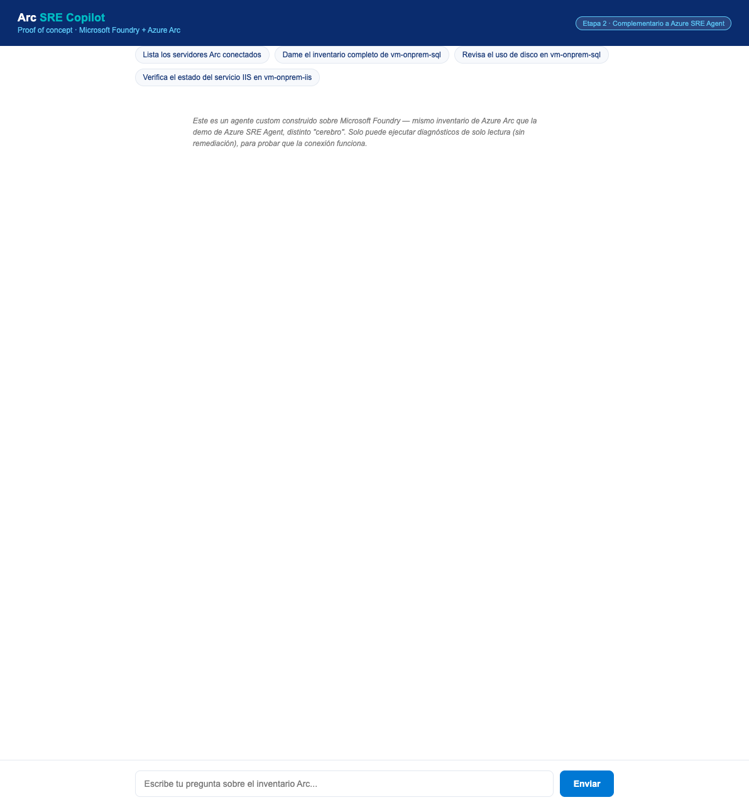
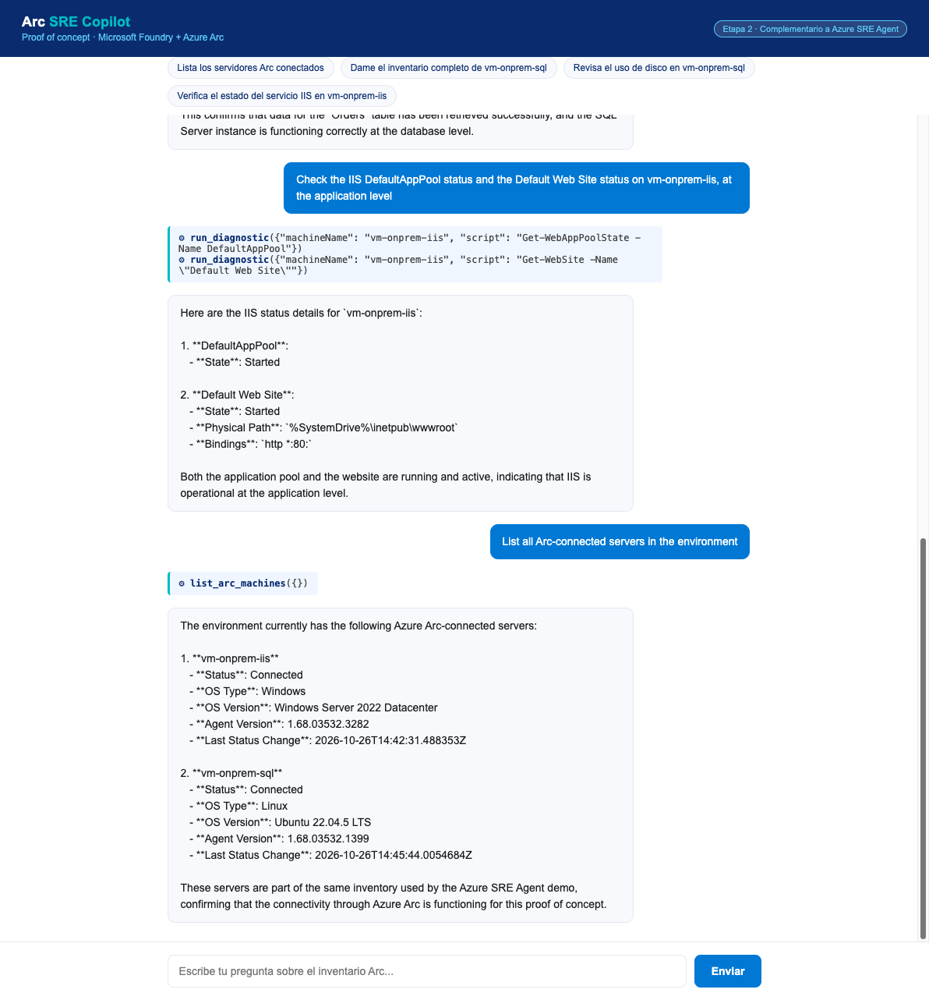
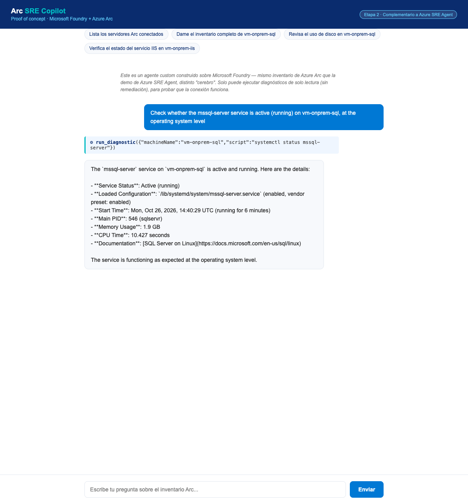
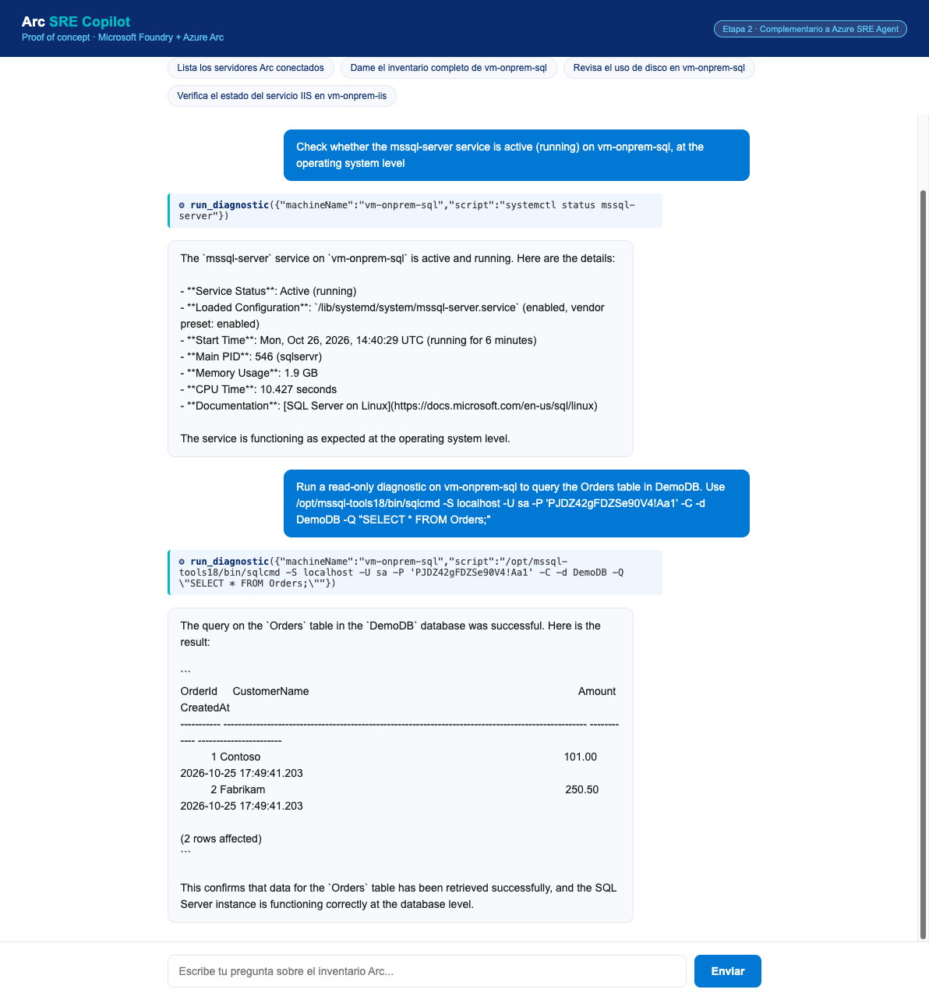
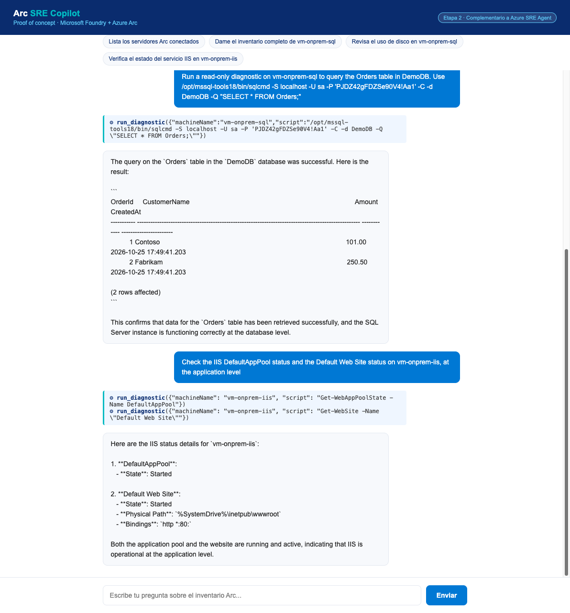

# Guía de la demo — Etapa 2: Agente custom en Microsoft Foundry sobre Azure Arc

> Esta guía sigue el mismo estándar que `docs/GUIDE.md` del repo original (`azure-sre-agent-customer-demo`): texto exacto para pegar en el chat + capturas reales del resultado, para que puedas navegar y narrar sin improvisar en vivo.

## El mensaje para el cliente

> "Lo que acaban de ver con Azure SRE Agent es el producto gestionado de Microsoft. Pero el puente real — Azure Arc — es independiente de qué 'cerebro' razona sobre él. Esto que les voy a mostrar ahora es un agente **custom**, construido sobre Microsoft Foundry, con su propio frontend, que lee **exactamente el mismo inventario de servidores** que acabamos de ver — sin que yo haya tocado nada de la demo anterior. Es la respuesta a: 'si necesitamos algo más a medida, ¿se puede?'"

## Qué valida esta demo

Tres capas distintas, cada una con un diagnóstico real (de solo lectura) ejecutado en vivo vía Azure Arc:

| Capa | Validación | Comando real ejecutado |
|---|---|---|
| **Sistema operativo** | Servicio `mssql-server` activo en Linux | `systemctl status mssql-server` |
| **Base de datos** | Consulta real sobre `DemoDB` | `sqlcmd ... -Q "SELECT * FROM Orders;"` |
| **IIS / aplicación web** | Estado del App Pool y del sitio en Windows | `Get-WebAppPoolState`, `Get-WebSite` |

Todo corre sobre `vm-onprem-sql` / `vm-onprem-iis` — las mismas 2 VMs de la demo principal.

---

## Paso 0 — La página de inicio



Frontend propio (no `sre.azure.com`), con la misma paleta de marca usada en el resto de la demo. El mensaje de advertencia en cursiva dentro del chat deja claro al cliente que esto es una prueba de concepto de **solo lectura** — sin remediación — por diseño de seguridad.

### Lo que tú haces
Simplemente abre la URL del Container App (ver `prompts/LAUNCH-DEMO.md` de este repo) y muestra la pantalla de inicio — ya tiene preguntas sugeridas (chips) para no tener que escribir nada en vivo si prefieres usarlas.

---

## Paso 1 — Confirmar que es el mismo inventario

### Guion exacto para pegar en el chat

```
List all Arc-connected servers in the environment
```

### Lo que vas a ver



El agente devuelve ambos servidores (`vm-onprem-iis`, `vm-onprem-sql`) con su estado real "Connected", versión del agente Arc, y cierra con la frase clave: *"These servers are part of the same inventory used by the Azure SRE Agent demo"*.

> **Por qué importa este paso**: es la prueba visual de que no se desplegó nada nuevo — es el mismo puente de Arc, vía un agente distinto.

---

## Paso 2 — Validación a nivel de sistema operativo

### Guion exacto

```
Check whether the mssql-server service is active (running) on vm-onprem-sql, at the operating system level
```

### Lo que vas a ver



El agente ejecuta `systemctl status mssql-server` real vía Arc Run Command y devuelve datos reales: PID, memoria, tiempo de CPU, hora de arranque — no es una respuesta genérica, es telemetría real del servidor.

---

## Paso 3 — Validación a nivel de base de datos

> **Antes de este paso**, igual que en la demo principal, el agente no conoce la contraseña `sa` (no vive en ningún archivo, por diseño) — se la das directamente en el mismo mensaje.

### Guion exacto

```
Run a read-only diagnostic on vm-onprem-sql to query the Orders table in DemoDB. Use /opt/mssql-tools18/bin/sqlcmd -S localhost -U sa -P '<SA_PASSWORD>' -C -d DemoDB -Q "SELECT * FROM Orders;"
```

*(Reemplaza `<SA_PASSWORD>` por la contraseña real — pídesela al asistente antes de la demo si no la tienes a mano.)*

### Lo que vas a ver



Consulta SQL real ejecutada contra `DemoDB`, con los datos reales de la tabla `Orders` (Contoso, Fabrikam) devueltos en el chat — la misma tabla que usamos en el Escenario 3 de la demo principal (blocking session).

### Nota operativa
Este es el único paso donde necesitas darle una credencial en el chat — exactamente igual que en el Escenario 3 de la demo principal. Si el cliente pregunta por el patrón productivo (sin contraseñas), recuerda el mismo recuadro de Entra ID + Key Vault que ya mostraste antes.

---

## Paso 4 — Validación a nivel de IIS / aplicación web

### Guion exacto

```
Check the IIS DefaultAppPool status and the Default Web Site status on vm-onprem-iis, at the application level
```

### Lo que vas a ver



Dos comandos PowerShell reales ejecutados vía Arc sobre el servidor Windows: `Get-WebAppPoolState` y `Get-WebSite`, confirmando que `DefaultAppPool` y `Default Web Site` están ambos "Started" — el mismo servidor del Escenario 2 de la demo principal.

---

## Paso 5 (opcional) — Mostrar el guardrail de seguridad

Si el cliente pregunta "¿y si le pido que apague algo?", puedes mostrarlo en vivo:

### Guion exacto

```
Run this exact diagnostic command on vm-onprem-sql using run_diagnostic and tell me the raw result: systemctl stop mssql-server
```

### Lo que vas a ver
El agente se niega — tanto por su propio juicio (el system prompt no permite acciones destructivas) como por un bloqueo explícito a nivel de código (deny-list de patrones de escritura) si de todas formas lo intentara. Es una doble capa de seguridad, útil para cerrar la conversación de "esto es seguro para producción, con los ajustes correctos".

---

## Cierre sugerido

> "Lo que acaban de ver prueba tres cosas: primero, que Azure Arc es el verdadero puente — cualquier 'cerebro' de IA puede consumirlo. Segundo, que esto no reemplazó nada de lo que ya vimos — la demo de Azure SRE Agent sigue funcionando exactamente igual. Y tercero, que para un cliente que necesite más personalización — su propio modelo, su propia lógica de negocio, su propia marca en el frontend — el camino existe y ya está probado, no es solo una idea en una diapositiva."

## Preparación antes de la demo

Ver `prompts/LAUNCH-DEMO.md` de este repo — necesitas encender las mismas 2 VMs de la demo principal (`vm-onprem-sql`, `vm-onprem-iis`) antes de que el agente Foundry pueda reportarlas como "Connected". Si el Container App está en `min-replicas 0` (modo ahorro), la primera respuesta puede tardar ~20-30 segundos extra mientras arranca el contenedor (cold start) — considera escalarlo a 1 réplica unos minutos antes si el tiempo es crítico.
